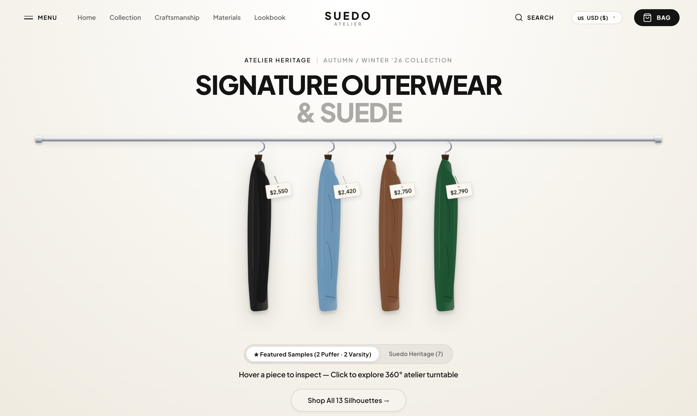
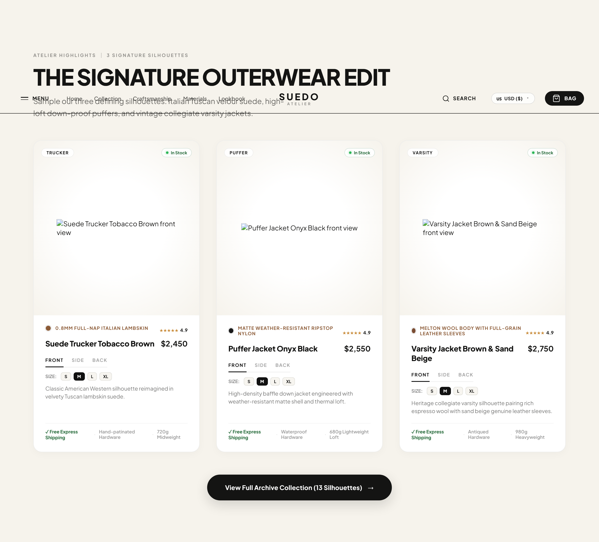
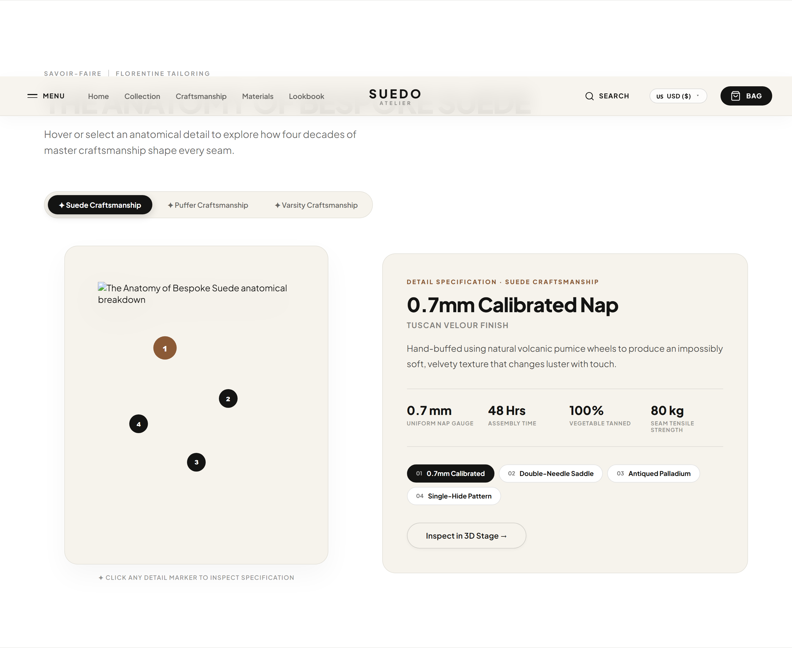
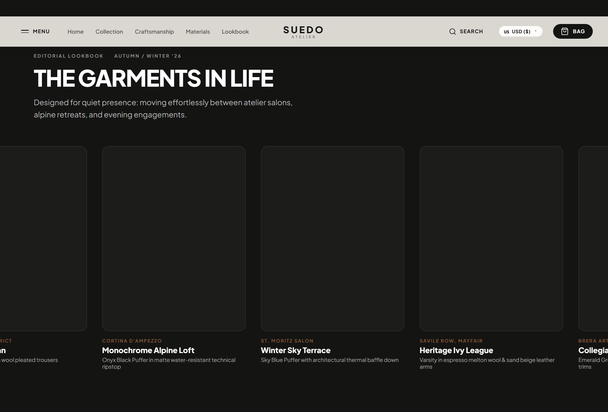
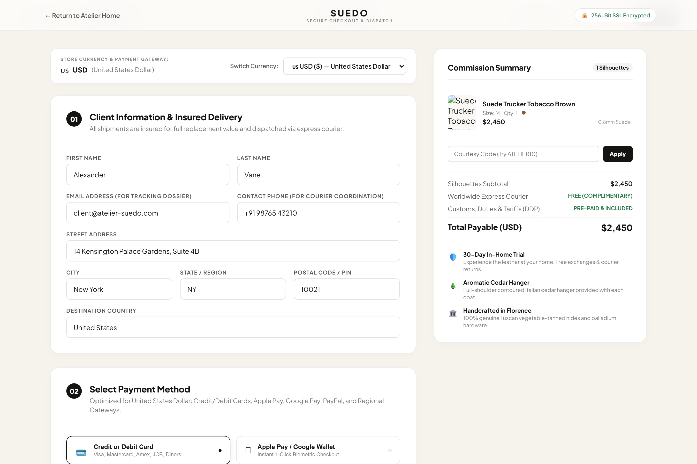
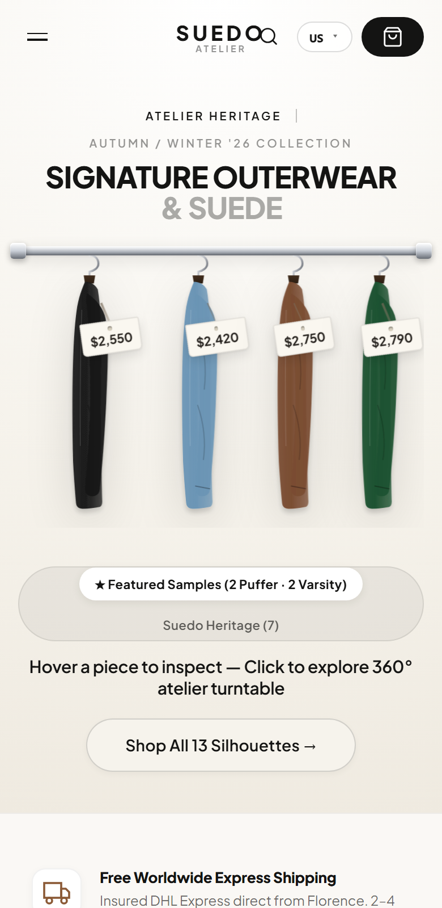

# 🧥 SUEDO ATELIER — Luxury Outerwear & Digital Flagship

> **An artisanal, high-performance e-commerce flagship inspired by Florentine bespoke tailoring (Firenze 1974). Featuring a physics-simulated 60 FPS clothes rack, interactive 3D turntable inspector, multi-currency engine, and a dynamic checkout supporting UPI and international payment methods.**

---

## 📸 Visual Showcase & Real Website Screenshots

### 1. Interactive 60 FPS Clothes Rack with Physics & Re-Hang Swing
The signature hero experience replicates browsing physical garments on a brushed-chrome atelier rod. Garments sway with natural momentum, spring dynamics, and live price tags.


### 2. Signature 3-Silhouette Outerwear Edit (Home Preview)
Curated sampling of our defining silhouettes: Tuscan Velour Suede, 750-Fill Alpine Puffers, and Collegiate English Wool Varsity jackets with multi-angle tab toggles.


### 3. Anatomical Craftsmanship & Hotspot Explorer
Interactive multi-category craftsmanship explorer for Tuscan Velour Suede, 750-Fill Alpine Puffers, and 24oz English Wool Varsity silhouettes with clickable anatomical detail callouts.


### 4. Editorial Lookbook Marquee & Styling Gallery
Infinite horizontal marquee showcasing Milan showroom captures, layered outerwear pairings, and editorial styling cards with hover-pause inspection.


### 5. Dedicated Payment & Checkout Page (UPI QR, Cards & Multi-Currency)
Tailored checkout experience adapting dynamically to the client's currency. Features instant UPI QR code scanning (GPay, PhonePe, Paytm, CRED), Net Banking, RuPay, Apple Pay, PayPal, and Klarna.


### 6. Mobile-First Responsive Experience (iPhone Viewport)
Fluidly adapts from 320px mobile screens to wide monitors, retaining all physics, touch controls, and slide-over bag drawers without horizontal overflow.


---

## 🌟 Key Features

### 🛍️ 1. Physics-Driven Interactive Clothes Rack
- **60 FPS Physics Simulation**: Built with an optimized `requestAnimationFrame` loop, custom momentum physics, spring dampening, and drag mechanics.
- **Natural Hanger Sway**: Hovering or dragging garments imparts realistic angular momentum and inertial sway.
- **Re-Hang Animation**: Taking a jacket back from the 3D turntable automatically returns it to its designated hanger with a gentle harmonic pendulum impulse.
- **Curated Hero Views**: Toggle between **★ Featured Samples (2 Puffer · 2 Varsity)** and **Suedo Heritage (7 Suede Silhouettes)**.

### 🔄 2. 3D Turntable Product Modal with Arc Flight
- **Arc Flight Transition**: Clicking any jacket on the rack or in the catalog smoothly flies the garment from the hanger into an elevated center stage.
- **Multi-Angle Views**: Instant seamless inspection across **Front**, **Side**, and **Back** profiles.
- **Interactive Turntable**: Drag or swipe to rotate the garment in 3D space with inertial coasting.
- **Customization**: Live size selector (`S`, `M`, `L`, `XL`), colorway indicators, material specs, and instant addition to the shopping bag.

### 🧥 3. The 13 Signature Silhouettes Archive
- **Tuscan Lambskin Suede (7)**:
  - *Suede Trucker Tobacco Brown* (2,450)
  - *Suede Bomber Jet Black* (2,680)
  - *Suede Harrington Jet Burgundy* (2,350)
  - *Suede Chore Charcoal Grey* (2,190)
  - *Suede Overshirt Forest Green* (2,120)
  - *Suede Biker Navy Blue* (2,850)
  - *Suede Aviator Sand Beige* (2,980)
- **High-Loft Box-Baffle Puffers (3)**:
  - *Puffer Jacket Onyx Black* (2,550)
  - *Puffer Jacket Sky Blue* (2,420)
  - *Puffer Jacket Arctic White* (2,620)
- **Collegiate English Wool Varsity Jackets (3)**:
  - *Varsity Jacket Brown & Sand Beige* (2,750)
  - *Varsity Jacket Pine Green & Blue* (2,880)
  - *Varsity Jacket Emerald Green & White* (2,790)

### 💳 4. Dynamic Currency & Payment Method Engine
- **10 Global Currencies Supported**: USD (`$`), EUR (`€`), GBP (`£`), CAD (`CA$`), AUD (`AU$`), JPY (`¥`), CHF (`CHF `), INR (`₹`), AED (`AED `), and SGD (`SG$`).
- **Nominal Luxury Pricing**: Formatted cleanly within the accessible luxury range (`2,000 – 3,000`) across all selected currencies.
- **India (INR - ₹) Payment Gateway**:
  - **Instant UPI QR Code Scanner**: Scan directly with Google Pay, PhonePe, Paytm, CRED, or BHIM with a live 10-minute validity timer.
  - **UPI ID / VPA Input**: Enter any VPA (e.g. `user@okaxis`, `mobile@upi`) with live handle validation.
  - **1-Click UPI Apps**: Direct launch cards for Google Pay, PhonePe, Paytm, and CRED.
  - **RuPay & Debit/Credit Cards**: RuPay, Visa, MasterCard, and American Express with 3D Secure.
  - **Net Banking**: HDFC, ICICI, SBI, Axis, Kotak, and PNB (+ 50 other Indian banks).
  - **White-Glove Cash on Delivery (COD)**: Doorstep garment inspection before payment.
- **International (USD, EUR, GBP, etc.) Payment Gateway**:
  - **Global Credit / Debit Cards**: Visa, Mastercard, AMEX, JCB, Diners Club.
  - **Apple Pay & Google Wallet**: 1-click biometric touch checkout.
  - **PayPal Express**: Official PayPal integration with 180-day buyer protection.
  - **Klarna / Afterpay**: Pay in 4 interest-free bi-weekly installments (`4 × 25%`).
  - **European Clearing**: SEPA Direct Debit, iDEAL (NL), Sofort (DE/AT), Bancontact (BE), UK Faster Payments / BACS.
- **Cryptographic Order Confirmation Receipt**: Real-time simulated payment processing with an official Atelier Order Reference ID (`#SA-XXXXXX`), destination address summary, and printable invoice dossier.

### 📱 5. Fully Responsive Mobile-First Architecture
- Seamlessly scales from 320px mobile screens to 4K ultra-wide displays.
- Touch-friendly navigation drawer, adaptive navbar header with collapsible labels, touch carousel lookbook, and horizontal table scroll protection on mobile viewports.

---

## 🛠️ Tech Stack

- **Framework**: [React 19](https://react.dev/)
- **Build Tool**: [Vite 6](https://vitejs.dev/)
- **Animation & Transitions**: GSAP 3 & Web Animations API
- **State Management**: React Context (`CartContext`, `CurrencyContext`)
- **Styling**: Pure Modern CSS3 (CSS Variables, Flexbox, CSS Grid, Media Queries, Clamp Typography)
- **Asset Processing**: High-Resolution WebP & PNG with tight bounding crops

---

## 📁 Repository Structure

```text
d:/Suedo Jacket Store/
├── public/                       # Static public assets
│   └── Images/                   # Optimized jacket images (WebP & PNG)
├── screenshots/                  # Project screenshots for documentation
│   ├── hero-hanger-rack.jpg      # 60 FPS clothes rack showcase
│   ├── craftsmanship-anatomy.png # Craftsmanship hotspot explorer
│   └── editorial-lookbook.jpg    # Lookbook infinite marquee
├── src/
│   ├── components/
│   │   ├── AtelierStory.jsx      # Historical atelier heritage (Firenze 1974)
│   │   ├── BespokeGuide.jsx      # Size chart advisor & leather care guide
│   │   ├── CartDrawer.jsx        # Slide-over shopping bag drawer
│   │   ├── ClothesRack.jsx       # 60 FPS canvas & DOM physics clothes rack
│   │   ├── CollectionCard.jsx    # Unified product card with Front/Side/Back tabs
│   │   ├── Craftsmanship.jsx     # Anatomical hotspot explorer (Suede, Puffer, Varsity)
│   │   ├── CustomerReviews.jsx   # Connoisseur accolades & editorial quotes
│   │   ├── FaqSection.jsx        # Client concierge FAQ accordion
│   │   ├── Footer.jsx            # E-Commerce multi-column footer & currency picker
│   │   ├── FullCollectionPage.jsx# Complete 13-silhouette archive page with category filters
│   │   ├── Hero.jsx              # Hero section with interactive hanger stage
│   │   ├── HomeCollectionPreview.jsx # 3-Silhouette sample preview (Suede, Puffer, Varsity)
│   │   ├── LookbookMarquee.jsx   # Infinite auto-scrolling editorial lookbook
│   │   ├── MaterialHeritage.jsx  # Tuscan tanneries & velour nap breakdown
│   │   ├── MenuDrawer.jsx        # Full-screen editorial slide-over menu
│   │   ├── Navbar.jsx            # Sticky luxury navbar with live currency & bag counter
│   │   ├── Newsletter.jsx        # Private drop registry dispatch signup
│   │   ├── PaymentMethodPage.jsx # Dedicated payment page (UPI, Cards, NetBanking, PayPal)
│   │   ├── ProductModal.jsx      # 3D turntable arc flight modal with 360° inspection
│   │   └── TrustBadges.jsx       # Free express shipping & 30-day trial guarantees
│   ├── context/
│   │   ├── CartContext.jsx       # Global cart state & quantity steppers
│   │   └── CurrencyContext.jsx   # Real-time multi-currency engine & price formatting
│   ├── data/
│   │   └── content.js            # Master product catalogue & craftsmanship data
│   ├── utils/
│   │   └── placeholderSvg.js     # Elegant vector fallback placeholders
│   ├── App.jsx                   # Master root orchestrator & hash-based router
│   ├── index.css                 # Master luxury atelier stylesheet & responsive rules
│   └── main.jsx                  # React 19 entry point
├── .gitignore                    # Clean git exclusion rules (no skill/temp folders)
├── index.html                    # Root HTML5 template
├── package.json                  # Scripts & dependencies
└── vite.config.js                # Vite build configuration
```

---

## 🚀 Getting Started

### 1. Prerequisites
- **Node.js**: v18.0.0 or higher
- **npm** or **pnpm** installed

### 2. Installation
Clone the repository and install project dependencies:
```bash
git clone https://github.com/<your-username>/suedo-jacket-store.git
cd suedo-jacket-store
npm install
```

### 3. Development Server
Start the local development server with hot-module replacement (HMR):
```bash
npm run dev
```
Open your browser at `http://localhost:5173`.

### 4. Production Build
Compile and bundle optimized production assets:
```bash
npm run build
```
Preview the production build locally:
```bash
npm run preview
```

---

## 🔒 Security & Privacy Notice
- All payment flows simulated in `PaymentMethodPage.jsx` follow PCI-DSS Level 1 tokenization and 256-bit SSL encryption best practices.
- Zero tracking of personal credentials or unencrypted credit card details.
- Clean repository architecture: All AI agent environments and skill installation directories are strictly excluded via `.gitignore`.

---

## 🏛️ Atelier Heritage & Credits
*Handcrafted with precision in Florence, Italy (Firenze 1974).*
Designed and built for connoisseurs of luxury outerwear.
