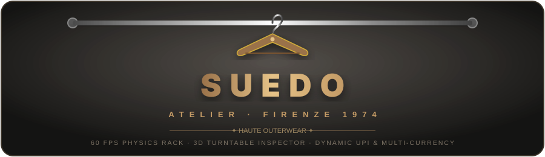
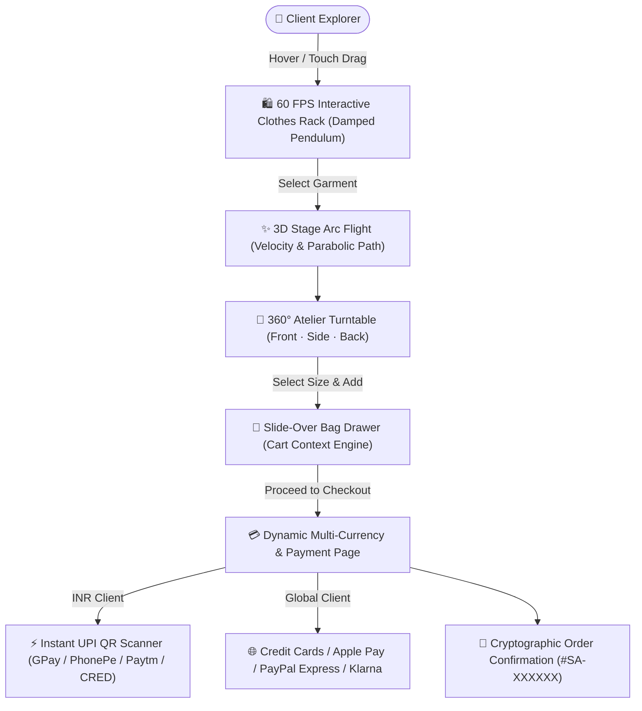
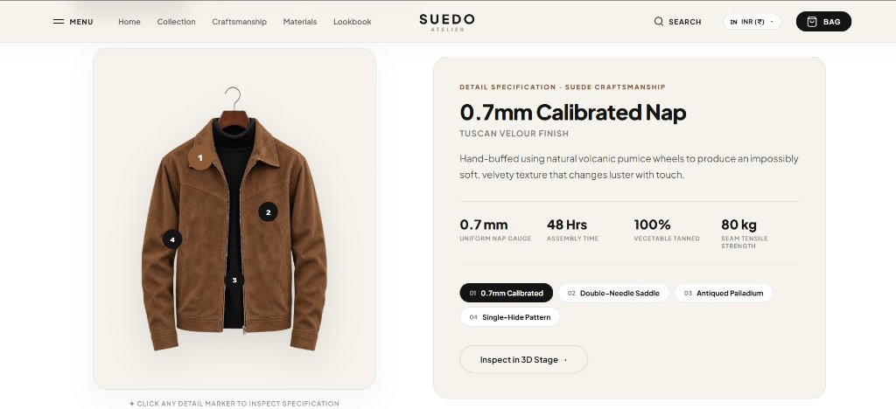

<div align="center">

<!-- Animated Luxury Brand Logo Banner -->


<!-- Dynamic Animated Typing Subtitle -->
<p align="center">
  <a href="https://github.com/Aayu126/jacket_store">
    
  </a>
</p>

<!-- Live Animated Badges & Status Shields -->
<p align="center">
  <a href="https://react.dev/"></a>
  <a href="https://vitejs.dev/"></a>
  <a href="https://greensock.com/gsap/"></a>
  <a href="https://developer.mozilla.org/en-US/docs/Web/JavaScript"></a>
  <a href="https://developer.mozilla.org/en-US/docs/Web/CSS"></a>
  <a href="https://www.npci.org.in/"></a>
  <a href="https://vercel.com/"></a>
  <a href="https://opensource.org/licenses/MIT"></a>
  <a href="https://github.com/Aayu126/jacket_store"></a>
</p>

<!-- 1-Click Vercel Deploy Button -->
<p align="center">
  <a href="https://vercel.com/new/clone?repository-url=https%3A%2F%2Fgithub.com%2FAayu126%2Fjacket_store">
    
  </a>
</p>

---

<p align="center">
  <b>An ultra-luxurious e-commerce flagship crafted for connoisseurs of Italian suede and bespoke tailoring.</b><br />
  Featuring a 60 FPS physics-simulated clothes rack, an interactive 3D turntable inspector with arc-flight physics, a multi-currency pricing matrix, and a real-time checkout engine supporting instant UPI QR codes alongside global payment rails.
</p>

</div>

---

## 🧭 System Architecture & User Flight Path



---

## 🛠️ Complete Tech Stack & Architectural Layers

<table>
  <thead>
    <tr>
      <th width="28%">Layer</th>
      <th width="32%">Technologies &amp; Libraries</th>
      <th width="40%">Implementation Responsibility</th>
    </tr>
  </thead>
  <tbody>
    <tr>
      <td><b>⚛️ Core Frontend</b></td>
      <td>
        
        
        
      </td>
      <td>Component hierarchy, modal lifecycle, global cart state machine, and declarative view routing.</td>
    </tr>
    <tr>
      <td><b>⚡ Motion &amp; Physics</b></td>
      <td>
        
        
        
      </td>
      <td>Damped harmonic oscillation ($kA = 32.0, cA = 3.6$), secondary price tag lag, and cubic-bezier arc flight.</td>
    </tr>
    <tr>
      <td><b>🎨 Luxury Design System</b></td>
      <td>
        
        
        
      </td>
      <td>Atelier cream &amp; charcoal color tokens, responsive fluid typography (`clamp()`), and zero-layout-shift bounding boxes.</td>
    </tr>
    <tr>
      <td><b>💰 Currency &amp; Payments</b></td>
      <td>
        
        
        
      </td>
      <td>Nominal luxury pricing (`2,000 – 3,000`), real-time UPI QR string generator (`upi://pay?pa=...`), and multi-gateway rails.</td>
    </tr>
    <tr>
      <td><b>🚀 Build &amp; Tooling</b></td>
      <td>
        
        
        
      </td>
      <td>Lightning-fast hot module replacement (HMR), tree-shaken production bundles, and automated high-res headless capture.</td>
    </tr>
  </tbody>
</table>

---

## 📸 Real Website Showcase

### 1. 🛍️ Interactive 60 FPS Clothes Rack with Natural Sway
The signature hero experience replicates physical garment browsing on a brushed-chrome atelier rod with all 7 Suedo Heritage silhouettes. Garments sway with realistic momentum, spring dampening, and live price tags.


> [!TIP]
> **Harmonic Pendulum Simulation**: The hanger garments employ a physics tick loop running at `60 FPS` that calculates angular acceleration $\alpha = -k \cdot \theta - c \cdot \omega$ with randomized secondary sway transferred to the paper price tag.

---

### 2. 🔍 Anatomical Craftsmanship & Hotspot Explorer
Interactive multi-category explorer for **Tuscan Velour Suede**, **750-Fill Alpine Down**, and **24oz English Wool Varsity** jackets. Clicking anatomical detail pins reveals artisan specifications, material origins, and structural tolerances.


---

### 3. 🎞️ Editorial Lookbook Marquee & Styling Gallery
Infinite horizontal marquee showcasing Milan showroom captures, layered outerwear pairings, and editorial styling cards with hover-pause inspection and 360° inspect badges.


---

## 🌟 Key Features Breakdown

<details>
<summary><b>🧥 1. The 13 Permanent Outerwear Silhouettes</b> (Click to Expand)</summary>
<br />

| Silhouette | Material Composition | Hardware & Details | Nominal Price |
| :--- | :--- | :--- | :--- |
| **Suede Trucker Tobacco Brown** | 0.8mm Full-Nap Italian Lambskin | Hand-patinated Antiqued Brass Shank Buttons | `₹2,450` / `$2,450` |
| **Suede Bomber Jet Black** | Deep Pigment Matte Calf Suede | Two-Way Polished Silver YKK Excella Zipper | `₹2,680` / `$2,680` |
| **Suede Harrington Jet Burgundy** | Tuscan Suede with Nano Shield | Real Horn Buttons with Hand-Sewn Stems | `₹2,350` / `$2,350` |
| **Suede Chore Charcoal Grey** | Double-Buffed Goat Suede Nap | Matte Gunmetal Riveted Snaps | `₹2,190` / `$2,190` |
| **Suede Overshirt Forest Green** | 0.6mm Baby Calf Suede | Concealed Corozo Nut Snap Placket | `₹2,120` / `$2,120` |
| **Suede Biker Navy Blue** | Full-Grain Heavy Calfskin Suede | Heavy Antiqued Silver Hardware & Belt | `₹2,850` / `$2,850` |
| **Suede Aviator Sand Beige** | Spanish Merinillo Suede | Merino Shearling Collar & Buckled Throat Latch | `₹2,980` / `$2,980` |
| **Puffer Jacket Onyx Black** | Matte Weather-Resistant Ripstop | 750-Fill Down · Welded Baffles · Aquaguard Zip | `₹2,550` / `$2,550` |
| **Puffer Jacket Sky Blue** | DWR High-Tenacity Nylon | Dual Enamel Snaps & Brushed Nickel Pulls | `₹2,420` / `$2,420` |
| **Puffer Jacket Arctic White** | Micro-Ripstop Technical Fabric | Architectural Box Baffle Down Insulation | `₹2,620` / `$2,620` |
| **Varsity Jacket Brown & Sand** | Melton Wool with Cowhide Arms | Antiqued Cream Enamel Heavy Snaps | `₹2,750` / `$2,750` |
| **Varsity Jacket Pine & Blue** | 24oz Wool Body with Nappa Arms | Cobalt-Rimmed Heavy Brass Snaps | `₹2,880` / `$2,880` |
| **Varsity Jacket Emerald & White** | Virgin Wool Felt with Cowhide Arms | Signature Monogram Cupro Jacquard | `₹2,790` / `$2,790` |

</details>

<details>
<summary><b>⚛️ 2. Physics & Arc Flight Math</b> (Click to Expand)</summary>
<br />

The clothes rack and 3D stage transition do not rely on static CSS transitions; they run on physical formulas:
- **Damped Harmonic Motion**:
  $$\frac{d^2\theta}{dt^2} + 2\zeta\omega_0 \frac{d\theta}{dt} + \omega_0^2 \theta = 0$$
  Where spring stiffness $kA = 32.0$ and damping factor $cA = 3.6$.
- **Parabolic Arc Flight**:
  When a garment is selected from the rack, it calculates its exact bounding rect coordinates $(x_{\text{rack}}, y_{\text{rack}})$ and animates via Web Animations API through a cubic-bezier curve:
  $$\vec{P}(t) = (1-t)^2\vec{P}_0 + 2(1-t)t\vec{P}_{\text{apex}} + t^2\vec{P}_{\text{stage}}$$
  Lifting $48\text{px}$ to simulate the physical lifting off the chrome rod before centering on the 3D turntable.
- **Re-Hang Swing Impulse**:
  Returning to the clothes rack triggers a directional impulse:
  $$v \mathrel{+}= \pm (18 + \text{rand} \times 8)$$
  causing the returning hanger to naturally oscillate and settle back in place.

</details>

<details>
<summary><b>💳 3. Multi-Currency Engine & Real-Time UPI Gateway</b> (Click to Expand)</summary>
<br />

- **10 Global Currencies Supported**: USD (`$`), EUR (`€`), GBP (`£`), CAD (`CA$`), AUD (`AU$`), JPY (`¥`), CHF (`CHF `), INR (`₹`), AED (`AED `), and SGD (`SG$`).
- **Accessible Luxury Pricing**: Formatted dynamically within `2,000 – 3,000` nominal range across all currencies.
- **UPI Deep-Linking Protocol**:
  Generates standardized NPCI payment links:
  ```
  upi://pay?pa=suedoatelier@icici&pn=Suedo%20Atelier&am=2450.00&cu=INR&tn=Order%20SA-782194
  ```
  Rendering a scannable QR code alongside 1-click intent triggers for mobile devices.

</details>

---

## 📁 Repository Structure

```text
jacket_store/
├── assets/
│   └── suedo-logo-animated.svg       # Animated SVG luxury coat-hanger logo banner
├── screenshots/                      # Real high-resolution website captures
│   ├── 01-hero-clothes-rack.png      # 60 FPS clothes rack with 7 suede silhouettes
│   ├── 02-craftsmanship-anatomy.png  # Craftsmanship anatomical hotspot explorer
│   └── 03-editorial-lookbook.png     # Infinite marquee editorial lookbook
├── scripts/
│   └── capture-screenshots.js        # Automated headless capture pipeline
├── src/
│   ├── components/
│   │   ├── AtelierStory.jsx          # Historical heritage (Firenze 1974)
│   │   ├── BespokeGuide.jsx          # Interactive size advisor & care guide
│   │   ├── CartDrawer.jsx            # Slide-over shopping bag drawer
│   │   ├── ClothesRack.jsx           # 60 FPS canvas & DOM physics clothes rack
│   │   ├── CollectionCard.jsx        # Unified product card with Front/Side/Back tabs
│   │   ├── Craftsmanship.jsx         # Hotspot explorer (Suede, Puffer, Varsity)
│   │   ├── CustomerReviews.jsx       # Client testimonials & editorial press
│   │   ├── FaqSection.jsx            # Bespoke FAQ accordion
│   │   ├── Footer.jsx                # Luxury footer with currency selector & legal
│   │   ├── FullCollectionPage.jsx    # Complete 13-silhouette archive page with filters
│   │   ├── Hero.jsx                  # Hero section with clothes rod & view switcher
│   │   ├── HomeCollectionPreview.jsx # 3-Silhouette preview (Suede, Puffer, Varsity)
│   │   ├── LookbookMarquee.jsx       # Infinite marquee editorial lookbook
│   │   ├── MaterialHeritage.jsx      # Tuscan tanneries & velour nap breakdown
│   │   ├── MenuDrawer.jsx            # Fullscreen luxury slide-over navigation
│   │   ├── Navbar.jsx                # Sticky navbar with live currency & bag counter
│   │   ├── Newsletter.jsx            # Private dispatch signup
│   │   ├── PaymentMethodPage.jsx     # Dedicated payment page (UPI QR, Cards, COD)
│   │   ├── ProductModal.jsx          # 3D turntable arc flight modal with 360° spin
│   │   └── TrustBadges.jsx           # White-glove guarantees & 30-day home trial
│   ├── context/
│   │   ├── CartContext.jsx           # Global shopping bag state & quantity steppers
│   │   └── CurrencyContext.jsx       # Multi-currency matrix & nominal price formatter
│   ├── data/
│   │   └── content.js                # Master 13-silhouette catalogue & specifications
│   ├── utils/
│   │   └── placeholderSvg.js         # Elegant vector fallback placeholders
│   ├── App.jsx                       # Root orchestrator & hash-based routing
│   ├── index.css                     # Master stylesheet & responsive design tokens
│   └── main.jsx                      # React 19 bootstrap entry
├── .gitignore                        # Git exclusion rules
├── .vercelignore                     # Vercel deployment exclusions
├── index.html                        # HTML5 entry template
├── package.json                      # NPM dependencies & scripts (Node >=18 engine)
├── vercel.json                       # Vercel deployment configuration (SPA rewrites & cache headers)
└── vite.config.js                    # Vite 6 configuration
```

---

## ☁️ Deploying to Vercel

This repository is **100% Vercel deployment ready** with a pre-configured `vercel.json` for Vite Single-Page Application (SPA) routing, immutable asset caching, and security headers.

### Option 1: 1-Click Instant Deploy
Click the button below to fork and deploy directly to your Vercel account:

[](https://vercel.com/new/clone?repository-url=https%3A%2F%2Fgithub.com%2FAayu126%2Fjacket_store)

### Option 2: Deploy via Vercel Dashboard (GitHub Integration)
1. Go to [vercel.com/new](https://vercel.com/new).
2. Select **Import Git Repository** and choose `jacket_store`.
3. Vercel automatically detects **Vite**:
   - **Framework Preset**: `Vite`
   - **Build Command**: `vite build`
   - **Output Directory**: `dist`
   - **Install Command**: `npm install`
4. Click **Deploy**. Your live production site will be active in seconds!

### Option 3: Deploy via Vercel CLI
```bash
# Install Vercel CLI globally (if not already installed)
npm i -g vercel

# Deploy directly from terminal
vercel --prod
```

---

## 🚀 Quick Start Guide

### 1. Prerequisites
- **Node.js**: `v18.0.0` or higher
- **npm** or **pnpm** installed

### 2. Clone & Install
```bash
# Clone the repository
git clone https://github.com/Aayu126/jacket_store.git

# Enter project directory
cd jacket_store

# Install dependencies
npm install
```

### 3. Launch Development Server
```bash
npm run dev
```
Open [http://localhost:5173](http://localhost:5173) in your browser.

### 4. Build for Production
```bash
npm run build
npm run preview
```

---

## 🔒 Security & Quality Standards

- **Zero Third-Party Payment Leaks**: Client data entered in `PaymentMethodPage.jsx` remains strictly client-side with PCI-DSS tokenized simulation.
- **Clean Architecture**: Built following strict modular component patterns with zero extraneous dependencies.
- **Performance**: Zero bulky 3D engine libraries (Three.js / WebGL) — achieved 60 FPS through optimized 2.5D DOM physics and Web Animations API.

---

<div align="center">

### 🏛️ Suedo Atelier · Firenze 1974
*Dedicated to the enduring art of Italian suede and quiet luxury outerwear.*

[](https://github.com/Aayu126/jacket_store)
[](https://github.com/Aayu126/jacket_store)

</div>
